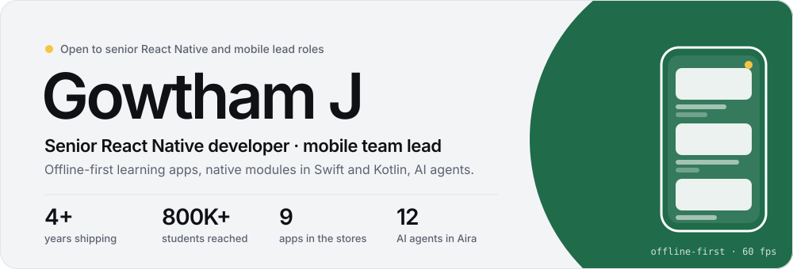
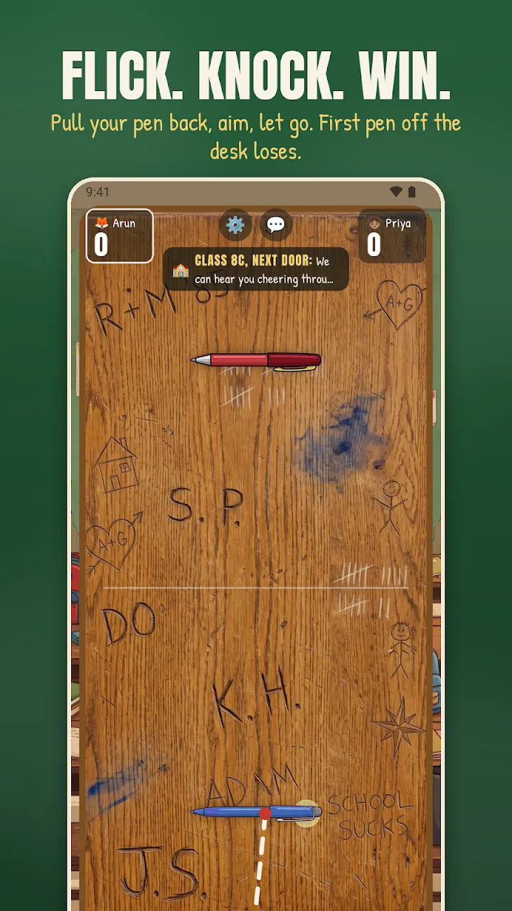
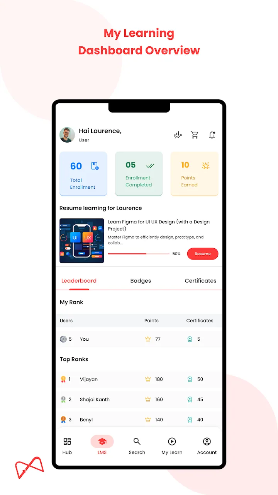
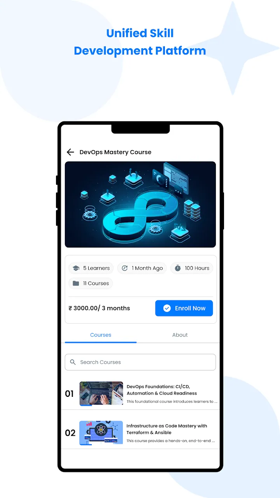
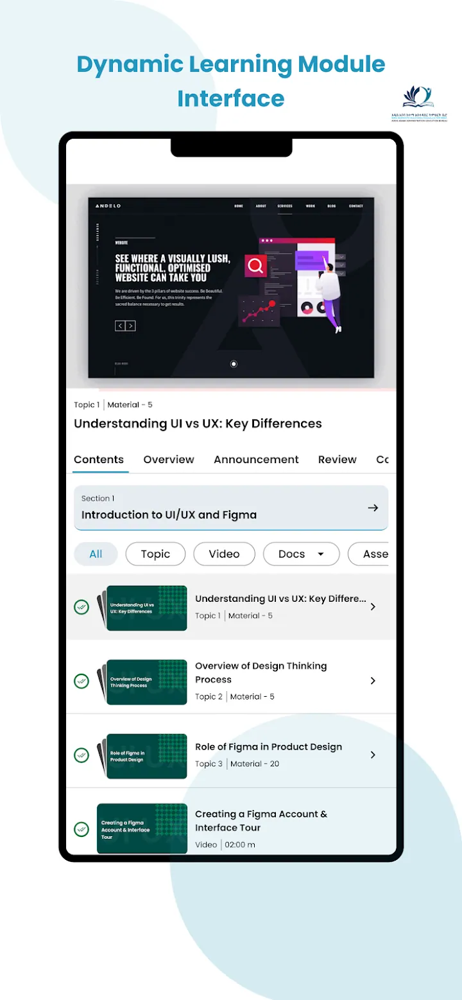
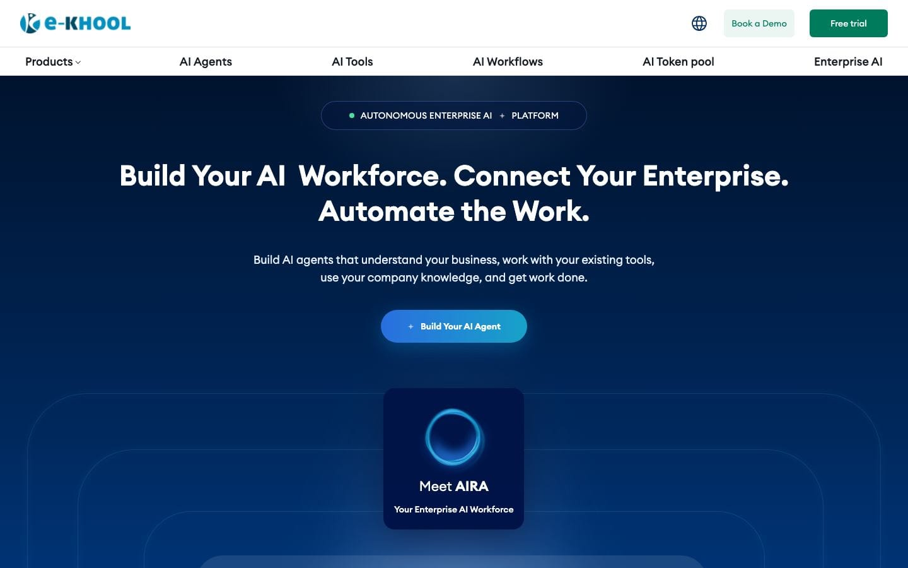
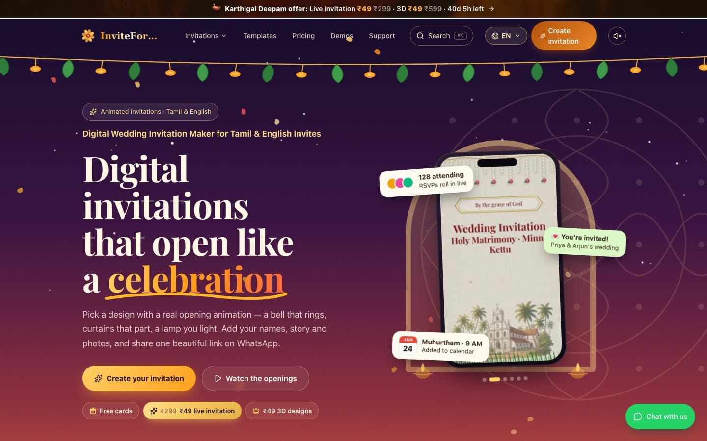

<picture>
  <source media="(prefers-color-scheme: dark)" srcset="assets/hero-dark.svg" />
  
</picture>

  
  
  
  
  
  
  

I build React Native apps that ship to real people on cheap Android phones and stay fast.
Most of my work sits in the hard parts of mobile: offline-first sync for one-bar villages,
native video players in Swift and Kotlin, encrypted downloads, and live exams for thousands
of students at once. Lately I also build the AI agents behind **[Aira](https://ekhool.com/aira)**.

<table>
<tr><td valign="top" width="90"><b>Now</b></td><td valign="top">Team lead at Resbee Info Technologies (e-Khool), leading 4 engineers</td></tr>
<tr><td valign="top" width="90"><b>Reach</b></td><td valign="top">Learning apps for 800K+ students in Tamil Nadu, Assam and Ethiopia, at 99.5% uptime</td></tr>
<tr><td valign="top" width="90"><b>Speed</b></td><td valign="top">New Architecture migration: startup 45% faster, 70% fewer crashes, 45 → 60 FPS</td></tr>
<tr><td valign="top" width="90"><b>Native</b></td><td valign="top">Encrypted video players in Swift and Kotlin, published to npm (5K+ downloads)</td></tr>
<tr><td valign="top" width="90"><b>AI</b></td><td valign="top">LangGraph agents, MCP tools that let Claude run the LMS, 40% faster student answers</td></tr>
</table>

## Selected work

<table>
<tr>
<td width="50%" valign="top">

### [Pen Fight](https://play.google.com/store/apps/details?id=com.penfight)
The last-bench desk game as a 60 FPS mobile game. Physics runs in a Reanimated worklet on
the UI thread and every frame is drawn with Skia. **1K+ installs.**

`React Native 0.86` `Skia` `Reanimated 4` `i18n`

[Get it on Google Play](https://play.google.com/store/apps/details?id=com.penfight) ·
[How I built it](https://medium.com/@gowthamjaganthan/i-rebuilt-pen-fight-the-last-bench-classic-as-a-60-fps-mobile-game-with-react-native-skia-eab5efb2caaf)

</td>
<td width="50%" align="center">

</td>
</tr>
<tr>
<td width="50%" valign="top">

### Learning apps for two governments
[MAAZTER](https://play.google.com/store/apps/details?id=com.maazter),
[e-Khool LMS](https://play.google.com/store/apps/details?id=com.ekhooltech) and
[AAEB eSchool](https://play.google.com/store/apps/details?id=com.aaeb). WatermelonDB sync,
AES-encrypted downloads that passed a government audit, live exams for 5,000 students at
once, 10+ languages with RTL. **800K+ users.**

`React Native` `WatermelonDB` `Swift / Kotlin` `Socket.IO` `AWS`

</td>
<td width="50%" align="center">

</td>
</tr>
<tr>
<td width="50%" valign="top">

### [Aira](https://ekhool.com/aira)
e-Khool's AI agent platform. I build the multi-agent orchestration (a LangGraph state machine
on FastAPI), the course agent where nine sub-agents each pass a 0–100 quality gate, and the
MCP tools that let Claude create courses inside a school's account.

`FastAPI` `LangGraph` `MCP` `MongoDB` `Claude / OpenAI / Gemini`

</td>
<td width="50%" align="center">

</td>
</tr>
<tr>
<td width="50%" valign="top">

### [InviteForYou](https://inviteforyou.in)
Animated Tamil and English invitations shared as one link: 69 designs with real opening
animations and 3D worlds, RSVPs, maps and music. Built with a partner, sold with Razorpay.

`Next.js` `Three.js` `Firebase` `next-intl` `Razorpay`

</td>
<td width="50%" align="center">

</td>
</tr>
<tr>
<td width="50%" valign="top">

### [Jewel Billing](https://billing-system-pi-tan.vercel.app)
GST bills, slip photos, payment tracking and a live sales dashboard, branded per shop.
Vitest and Playwright run on every pull request.

`React` `Vite` `Vitest` `Playwright` `GitHub Actions`

</td>
<td width="50%" align="center">

</td>
</tr>
</table>

More on the [portfolio](https://gowthamdev.vercel.app) and the
[Google Play listing](https://play.google.com/store/apps/dev?id=8170755285088488138).

## Experience

<table>
<tr><td valign="top" width="190"><b>Oct 2024 – now</b> Resbee Info Technologies (e-Khool)</td><td valign="top"><b>Full-stack developer, team lead.</b> Lead 4 engineers on government and enterprise LMS platforms for 800K+ users. Build Aira's agent orchestration and MCP tools. Offline-first sync that cut sync failures 60%. Moved the apps to the New Architecture. <code>React Native</code> <code>FastAPI</code> <code>LangGraph</code> <code>Firebase</code> <code>AWS</code></td></tr>
<tr><td valign="top" width="190"><b>Mar 2023 – Oct 2024</b> Radaz Technologies</td><td valign="top"><b>React Native developer.</b> Shipped 3 Android and iOS apps in IoT and e-commerce. ESP32/MQTT monitoring halved alert response time. Live tracking for 10K+ daily users. CodePush cut hotfixes from 2 days to 2 hours. <code>React Native</code> <code>MQTT</code> <code>Google Maps</code> <code>CodePush</code></td></tr>
<tr><td valign="top" width="190"><b>2024 – now</b> Purple Info Tech</td><td valign="top"><b>My own studio.</b> Games, apps and websites on my own Google Play account: Pen Fight, InviteForYou, Jewel Billing and sites for local shops. <code>React Native</code> <code>Next.js</code> <code>Astro</code></td></tr>
</table>

## Stack

<picture>
  <source media="(prefers-color-scheme: dark)" srcset="https://skillicons.dev/icons?i=react,ts,js,kotlin,swift,androidstudio,nextjs,nodejs,py,fastapi,firebase,mongodb,aws,docker,githubactions&perline=15&theme=dark" />
  
</picture>

**Daily:** `Reanimated` `Skia` `WatermelonDB` `MMKV` `Redux Toolkit` `TanStack Query` `Socket.IO` `Fabric / TurboModules` 
**AI:** `LangGraph` `LangChain` `MCP` `Claude` `OpenAI` `Gemini` `Ollama`

## Writing

<table>
<tr>
<td width="50%" valign="top">

**On [Medium](https://medium.com/@gowthamjaganthan)**

<!-- BLOG-POST-LIST:START -->
- [Relighting a Photo, and My Live Selfie Camera, with One Skia Shader in React Native](https://medium.com/@gowthamjaganthan/relighting-a-photo-and-my-live-selfie-camera-with-one-skia-shader-in-react-native-0258b1b73d4a)
- [I Turned My Bio Into a Statue of Me: A Letters-to-Portrait Animation with React Native Skia](https://medium.com/@gowthamjaganthan/i-turned-my-bio-into-a-statue-of-me-a-letters-to-portrait-animation-with-react-native-skia-d22b815bc726)
- [How I Automated My LinkedIn Posts with Claude: The Complete Setup, My First Post, and Every Mistake…](https://medium.com/@gowthamjaganthan/how-i-automated-my-linkedin-posts-with-claude-the-complete-setup-my-first-post-and-every-mistake-0c1411319fc9)
- [Claude’s Hidden “Reset for Free” Button: How to Restore Your Session and Weekly Limits Instantly](https://medium.com/@gowthamjaganthan/claudes-hidden-reset-for-free-button-how-to-restore-your-session-and-weekly-limits-instantly-d1e293faac3b)
- [How I Cut My App’s Download Size by 44% Without Removing a Single Feature](https://medium.com/@gowthamjaganthan/how-i-cut-my-apps-download-size-by-44-without-removing-a-single-feature-861c0f31984b)
<!-- BLOG-POST-LIST:END -->

</td>
<td width="50%" valign="top">

**On [YouTube](https://www.youtube.com/@learn_with_gowtham)**

<!-- YOUTUBE-LIST:START -->
- [Pen Fight: Winter Fest gameplay](https://www.youtube.com/shorts/n3a9LaMgvD4)
- [I Made a 2D Photo Look 3D | React Native + Skia](https://www.youtube.com/shorts/U782CkaAaLo)
- [I recreated the “text turns into a statue”, built out of 4,800 letters of my own bio](https://www.youtube.com/shorts/wDdwSFc20cM)
- [I Built the Pen Fight Game in React Native (Skia + 60 FPS Physics) — Part 2](https://www.youtube.com/watch?v=IxJ5YlnsFgE)
<!-- YOUTUBE-LIST:END -->

</td>
</tr>
</table>

Both lists refresh daily from the feeds.

## Open source here

| Repo | What it is |
|---|---|
| [Audio-generation](https://github.com/Gowtham8940/Audio-generation) | Lesson text to downloadable speech with local, open-source TTS. No cloud keys. `React` `FastAPI` `Docker` |
| [Voice-text-AI](https://github.com/Gowtham8940/Voice-text-AI) | Free multilingual speech-to-text built on Whisper. `Whisper` `Node.js` `Python` |
| [GowthamPortfolio](https://github.com/Gowtham8940/GowthamPortfolio) | My portfolio: Next.js, GSAP, a WebGL hero, English and Tamil. `Next.js` `Three.js` `GSAP` |

## Activity

<picture>
  <source media="(prefers-color-scheme: dark)" srcset="https://streak-stats.demolab.com/?user=Gowtham8940&hide_border=true&background=0E1210&ring=4CC38A&fire=F5C542&currStreakNum=ECEFEA&sideNums=ECEFEA&currStreakLabel=4CC38A&sideLabels=9BA39E&dates=9BA39E&stroke=26302B" />
  
</picture>

<picture>
  <source media="(prefers-color-scheme: dark)" srcset="https://github-readme-activity-graph.vercel.app/graph?username=Gowtham8940&bg_color=0E1210&color=9BA39E&line=4CC38A&point=F5C542&area=true&area_color=4CC38A&title_color=ECEFEA&hide_border=true&custom_title=Contributions%2C%20last%2031%20days" />
  
</picture>

  

<picture>
  <source media="(prefers-color-scheme: dark)" srcset="assets/footer-dark.svg" />
  
</picture>
