 

 

### 📲 &nbsp;Tap an app to open it

*Everything below is collapsible — open only what you care about.*

 

<b>&nbsp;👨‍💻&nbsp;&nbsp;About&nbsp;</b> — who I am and what I build

 

I build production React Native apps — the kind that ship to real users on low-end
Android devices and stay fast. Most of my work lives in the awkward parts of mobile:
offline-first sync, native modules, encrypted media, and real-time communication.

|  |  |
|---|---|
| 📱 **3.6+ years** | Shipping React Native to Android & iOS |
| 👨‍💼 **Team Lead** | Managed mobile teams of up to 4 engineers |
| 🌍 **800K+ users** | Government-scale apps across India & Ethiopia |
| ⚡ **New Architecture** | Fabric & TurboModules in production |
| 🔥 **Native** | Swift and Kotlin module development |
| 🤖 **AI** | OpenAI, LangChain & MCP in mobile apps |
| 📍 **Based in** | Tamil Nadu, India — open to relocation |

<b>&nbsp;🧩&nbsp;&nbsp;Projects&nbsp;</b> — what I have shipped

 

### 🖊️ [Pen Fight](https://github.com/Gowtham8940/pen-fight)

The last-bench desk game, as a mobile app. The physics runs in a Reanimated
**worklet on the UI thread** — off the JS thread entirely — so it holds 60fps on
low-end devices.

`React Native 0.86` `Skia` `Reanimated 4` `Zustand` `MMKV` `i18n + RTL`

---

### 🔊 [AI Audio Generator](https://github.com/Gowtham8940/Audio-generation)

Turns lesson text into downloadable speech using **entirely local, open-source TTS**.
No cloud APIs, no keys, no internet after the first model download.

`React` `FastAPI` `Python` `Docker`

---

### 💧 [Aqua Mart Associates](https://github.com/Gowtham8940/aqua-mart-associates)

Marketing site for an RO & water-recycling plant contractor. Below-the-fold sections
are `React.lazy` + `Suspense` code-split, so the initial bundle only pays for what is
above the fold.

`Vite` `React 18` `Tailwind v4` `Framer Motion`

---

### 🎙️ [Voice to Text AI](https://github.com/Gowtham8940/Voice-text-AI)

Free, open-source, multilingual speech-to-text built on Whisper.

`Whisper` `Node.js` `Python`

---

### 🛒 [Suya Mobiles](https://github.com/Gowtham8940/Suya-Mobiles)

Multi-role e-commerce app with payments and maps integration.

`React Native` `Firebase` `Razorpay` `Google Maps` `MMKV`

---

**More React Native work:**
[FocusTimer](https://github.com/Gowtham8940/FocusTimer) ·
[BellBoy](https://github.com/Gowtham8940/BellBoyApp) ·
[Attendance](https://github.com/Gowtham8940/Attendance-App) ·
[Uber Clone](https://github.com/Gowtham8940/Uber-App) ·
[Portfolio](https://github.com/Gowtham8940/GowthamPortfolio)

<b>&nbsp;🛠️&nbsp;&nbsp;Stack&nbsp;</b> — the tools I reach for

 

**Languages**

**Mobile & Frontend**

**Backend & Cloud**

**Tools**

**Also in daily use**

`Redux Toolkit` `TanStack Query` `WatermelonDB` `MMKV` `Reanimated` `Skia`
`Socket.IO` `RabbitMQ` `OpenAI` `LangChain` `MCP`

<b>&nbsp;📊&nbsp;&nbsp;Stats&nbsp;</b> — the receipts

 

<b>&nbsp;🎥&nbsp;&nbsp;YouTube&nbsp;</b> — Learn With Gowtham

 

I make videos on React Native, JavaScript & TypeScript, Firebase, mobile app
development, interview preparation, and career growth.

<b>&nbsp;🎯&nbsp;&nbsp;Currently&nbsp;</b> — what I am into right now

 

- React Native **0.85+** and the New Architecture — Fabric & TurboModules
- **AI-powered mobile apps** — LangChain, MCP, on-device inference
- **Offline-first** systems and conflict resolution
- Native module development in **Swift** and **Kotlin**
- **Android TV** applications
- Mobile **system design**

<b>&nbsp;📬&nbsp;&nbsp;Contact&nbsp;</b> — let us talk

 

Open to **senior React Native roles**, **mobile leadership**, and interesting
freelance work. Relocation is on the table.

- 💼 **LinkedIn** — [gowthamjagan](https://linkedin.com/in/gowthamjagan)
- 📧 **Email** — [gowthamjaganthan@gmail.com](mailto:gowthamjaganthan@gmail.com)
- 🎥 **YouTube** — [@learn_with_gowtham](https://www.youtube.com/@learn_with_gowtham)

 

**Building mobile apps that scale.**

⭐ Star a repo if it is useful to you.

